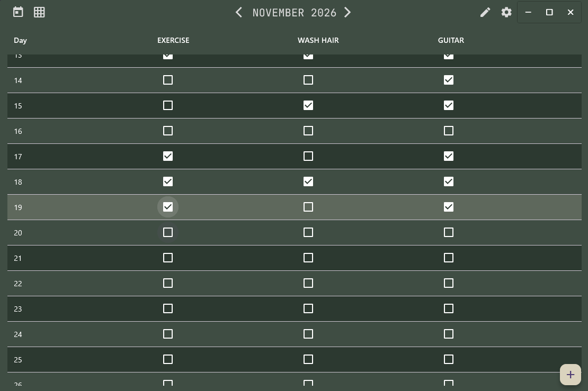
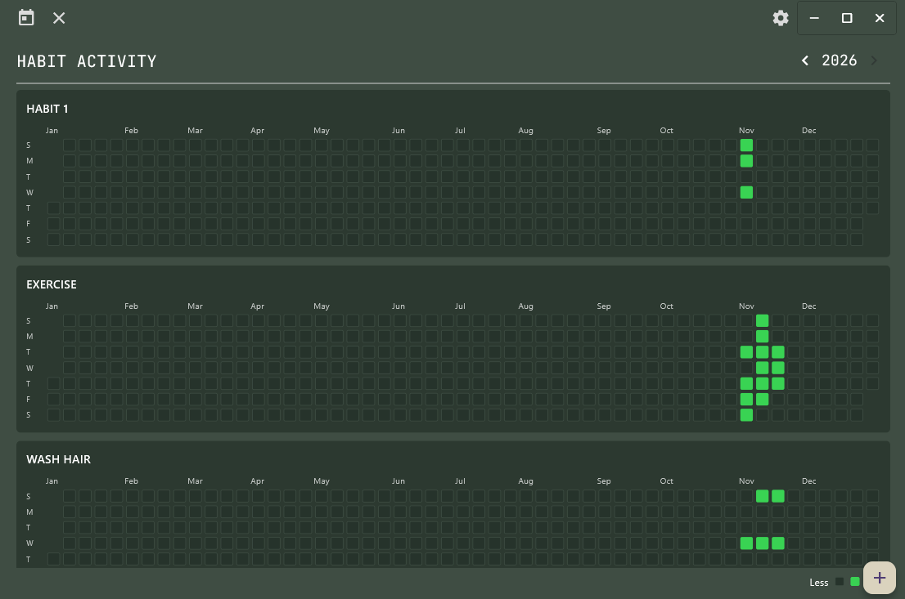

<div align="center">

  

  # Habit Tracker

  **A local habit tracker with month-by-month check-ins and yearly activity heatmaps.**

  Create habits, track daily progress, customize each month, and keep a visual record of your consistency.

  [](https://flutter.dev)
  [](https://dart.dev)
  [](https://www.sqlite.org)
  [](LICENSE)

</div>

## Screenshots

<div align="center">

| Monthly habit tracker | Yearly habit heatmaps |
|:---:|:---:|
|  |  |

</div>

## Features

- **Month-by-month tracking:** A daily checkbox table for every day in the selected month, with saved completion status.
- **Flexible habit sets:** Global habits provide defaults; each month can have its own additional or removed habits.
- **Yearly heatmaps:** View a responsive, GitHub-style calendar for each habit and navigate across years.
- **Local SQLite storage:** Habits, month assignments, and completion records stay in the app's local database.
- **Import and export:** Save a complete database backup or restore one. Import warns before replacing current data.
- **Custom Windows chrome:** A frameless, draggable header with minimize, maximize/restore, and close controls.
- **Quick navigation:** Jump to today, navigate months, and highlight the current day.

## Getting Started

### Requirements

- Flutter `3.38` or newer with Dart SDK `3.13` or newer
- For Windows builds, Visual Studio with the **Desktop development with C++** workload

### Run the app

```shell
flutter pub get
flutter run -d windows
```

### Build a Windows release

```shell
flutter build windows
```

The release executable is created under `build/windows/x64/runner/Release/`.

## Using Habit Tracker

1. Use the **+** button to create global habits. These are the default set for new months.
2. Use the month arrows to choose a month. Use **Edit Month** to add or remove habits for that month without changing other months.
3. Check a box to record a completed habit for that date. Unchecking it removes that completion from the database.
4. Select the heatmap button to view a separate activity calendar for each habit. Use the year arrows to review earlier activity; the close button returns to the table.
5. Open **Settings** to export a backup or import one. Importing replaces the current data after confirmation.

## Data Storage

Habit definitions, month-specific habit sets, and completion records are stored locally in SQLite. On Windows, the database is saved at `%APPDATA%\com.ravish.habit\Habit Tracker\habit_tracker.db`. No account or cloud service is required.

Backups are complete SQLite database files (`.db`). Keep exported backups somewhere safe; importing one replaces all current habits and completion history.

## Tech Stack

- [Flutter](https://flutter.dev) and [Dart](https://dart.dev)
- [SQLite](https://www.sqlite.org) via `sqflite_common_ffi`
- [file_picker](https://pub.dev/packages/file_picker) for backup file selection
- [window_manager](https://pub.dev/packages/window_manager) for custom Windows window controls

## License

This project is distributed under the [MIT License](LICENSE).
